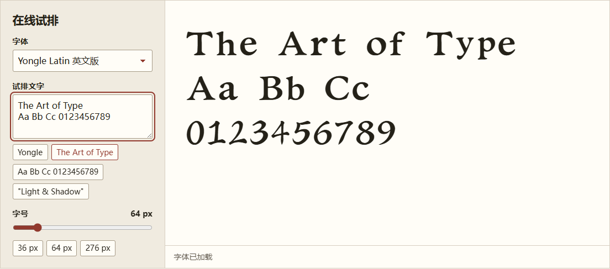

# 永乐 · Yongle

永乐是一款从《永乐大典》抄本笔意出发设计的中文标题字体。简体常用版保留楷书的提按和转折，适合书刊标题、海报和屏显大字。制作过程包括 AI 辅助生成、轮廓提取、部件组字和字形校对。

## 在线试排

**[打开永乐试排页](https://manibookmark.github.io/Yongle/)**。可输入自己的文字、切换简体常用版和英文版，并调整字号。超出字库的字符会标明使用了系统字体。

## 下载与安装

| 字体 | 适用场景 | 下载 |
| --- | --- | --- |
| 永乐 简体常用版 | 中文标题和中英混排。覆盖 3,500 个一级汉字及 128 个配套字符。 | [简体常用版 ZIP](https://github.com/manibookmark/Yongle/releases/download/v1.0.0/Yongle-SCCommon-v1.0.0.zip) |
| Yongle Latin | 英文标题。覆盖 99 个字符，包括 A–Z、a–z、数字、空格和常用标点。 | [英文版 ZIP](https://github.com/manibookmark/Yongle/releases/download/latin-v1.0.0/Yongle-Latin-v1.0.0.zip) |

解压后安装 TTF，在软件的字体列表里选择对应名称。两版可以同时安装。

## 许可证

[`OFL.txt`](OFL.txt) 是字体的 SIL Open Font License 1.1 许可证。可以免费用于个人及商业设计，也可以嵌入和修改字体。转发或打包分发字体文件时，请附上版权声明和许可证。不得单独出售字体文件。
