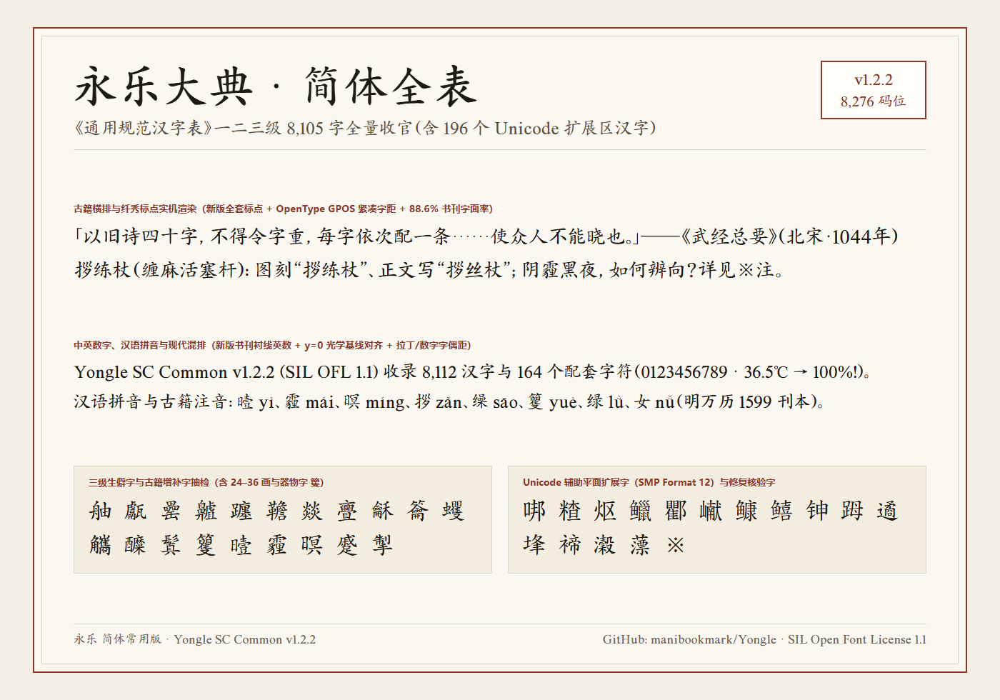

# 永乐 · Yongle

**永乐**是一款基于明代公版《永乐大典》留存抄本笔意打造、免费开源可商用的简体中文字体（SIL OFL 1.1 协议）。

简体常用版保留明初官修台阁体的横细竖粗、微扛肩与圆润折肩顿笔，同时针对现代简体字结构、连续横排阅读与中英数字混排做了系统性字重与基线校准。本仓库同时开源了造字过程中提炼的通用 AI 中文字体设计 Skill **`cjk-ai-font-design`**（MIT 协议），方便大家借助自己的 AI Agent 打造属于自己的中文字体。

> 字体目前仍在持续打磨完善中，如果你在使用或在线试排时发现任何错字、字形瑕疵或中英标点排版问题，欢迎随时提 [Issue](https://github.com/manibookmark/Yongle/issues) 反馈！

## 在线试排

**[打开永乐在线试排页](https://manibookmark.github.io/Yongle/)**。可输入任意中文、英文、数字与标点实时预览，支持切换字号，超出字库的字符会自动提示。



## 下载与安装

| 字体 | 适用场景 | 下载 |
| --- | --- | --- |
| 永乐 简体常用版 | 中文标题、正文与中英数字混排。**v1.2.2**，完整覆盖《通用规范汉字表》**一级 3,500 + 二级 3,000 + 三级 1,605 全部 8,105 个国标规范汉字**（另含 7 个古籍增补字，总计 8,112 汉字，含 196 个 Unicode SMP 扩展区汉字）及 164 个全套重建的纤秀书刊标点、拉丁字母、数字与汉语拼音，全库 **8,276** 码位。 | [简体常用版 ZIP（v1.2.2）](https://github.com/manibookmark/Yongle/releases/download/v1.2.2/Yongle-SCCommon-v1.2.2.zip) |
| Yongle Latin | 英文标题。覆盖 99 个字符，包括 A–Z、a–z、数字、空格和常用标点。 | [英文版 ZIP](https://github.com/manibookmark/Yongle/releases/download/latin-v1.0.0/Yongle-Latin-v1.0.0.zip) |

解压后安装 TTF，在软件的字体列表里选择对应名称即可。

### v1.2.2 主要更新

- **全套 164 个非汉字配套字符按真实长文混排母样全面重建（8,112 汉字逐点零改动）**：以视频与书刊真实长句混排样张为视觉母版，成套重造全部中文标点（`，。、；：？！“”‘’（）《》〈〉「」『』【】〔〕——……·※￥％×`）、经典竖挺横轻书刊衬线英文字母（`A–Z`、`a–z`）、阿拉伯数字（`0–9`）、24 个汉语拼音声调母音（`ā–ǜ`）及半角符号，并逐字校验确保全部 8,112 个汉字轮廓与水平度量 bit-for-bit 不变；
- **纤秀标点笔形与紧凑连排节奏（OpenType `GPOS kern` 升级）**：将双引号 `“”` 改为纤巧对称造型、句号 `。` 精修为细环空心圆、全面收瘦 `？（）《》【】〔〕「」『』` 线形并收紧 `，。、；：` 后置留白；重写 OpenType `GPOS kern` 连标点字距表（彻底消除 `”、` `”，` 重叠并补齐 `《`/`〈` 覆盖），同时新增拉丁与数字常用字偶距（`AV`/`Yo`/`Ta`/`10`/`14` 等）；
- **统一 `y = 0` 光学基线与 `OS/2` 度量补齐**：`0–9`、`A–Z`、`a–z`、全部 24 声调拼音与半角标点统一贴齐标准基线 `y = 0`（圆底过冲 `-10..-12`，`i` 族从 `+54` 归零），`ǚ` 顶高由 `891` 降至 `732` 彻底消除小字切顶风险；补齐真实的 `OS/2.sCapHeight = 701` 与 `OS/2.sxHeight = 481`；
- **古籍生僻字微调与补字**：定向微扩 `曀`、`霾`、`暝` 内白以提升 `18px` 小字号通透度，微收 `蹙`、`掣` 纵向极值，并新增古籍文献高频字符 **`※`（`U+203B`）** 与 **`籰`（`U+7C70`）**，全库增至 **8,276** 码位。

### v1.2.0 主要更新

- **完整补齐全部 1,605 个国标三级规范汉字，《通用规范汉字表》8,105 字全量收官**：全库从 6,510 汉字扩充至 **8,111 汉字**（100% 覆盖国标一级 3,500 + 二级 3,000 + 三级 1,605 全部 8,105 规范汉字 + 6 个古籍增补字），全库 **8,274 码位**（含 163 个永乐笔意英数标点与汉语拼音）；
- **全面覆盖 196 个 Unicode 辅助平面扩展汉字（SMP Format 12）**：含 `𠳐`、`𥻗`、`𬉼`、`𫚭`、`𨟠`、`𪩘`、`𩾌`、`𬶮`、`𬬹`、`𧿹` 等全部 196 个国标 SMP 汉字，同时补齐 `舳`、`甗`、`罍`、`齇`、`躔`、`韂`、`燚`、`亹`、`龢`、`籥`、`蠼`、`觿`、`醾`、`鬒` 等全量三级古籍与生僻字；
- **全量双参考一致性与零错字质检**：101 组 4×4 密度均衡字板全部采用永乐风格母版 + 楷体/思源宋体双参考生成、`--keep-sheet-scale` 与 `v1.1.1` `+8.5%` 字面率严格对齐（全库估算笔宽中位数稳定维持 `46.9`），7 波全量自动化结构审计加人工逐页实图核验，检出并双参考重绘修复全部 7 个错字（`遹`、`鿍`、`褯`、`𧿹`、`瀔`、`薸`、`𬬹`），全库 8,274 码位 TTF/WOFF2 逐点一致、24/48/96px 无空白字形；
- **完整延续 `v1.1.1` 标点与排印校准**：贴边中文标点、OpenType `GPOS kern` 连标点压缩、等距六点省略号 `……`、无缝破折号 `——` 与 88.6% 书刊字面率。

### v1.1.1 主要更新

- **标点基线贴边与节奏精修**：参照国标出版物与思源宋体排布规律，将 `，。、；` 锚定至汉字底脚基线并紧贴前字（`lsb=42–48`）、右侧留出自然停顿呼吸（`aw=680–700`）；收紧 `「『（《〈【〔“‘` 与 `」』）》〉】〕”’` 内侧贴边（`38–42`）并上下对齐全字框；精修六点省略号 `……` 笔触圆点大小与绝对等距；全面升级 **OpenType `GPOS kern`** 连标点压缩表（覆盖 `。」`、`》（`、`》《`、`》，`、`」：`、`：「`、`：“` 等全组合）；
- **全库字面率提升 +8.5%**：全部 6,510 汉字等比校准至约 `886×811 / 1000` 书刊黄金字面率（英数与拼音同步 +5.5% 协调对齐），同字号下字距更紧实、视觉饱满度大幅提升。

### v1.1.0 主要更新

- **完整补齐全部 3,000 个国标二级常用简体汉字**：全库从 3,586 汉字大幅扩充至 **6,510 汉字**（100% 覆盖《通用规范汉字表》一级 3,500 字 + 二级 3,000 字全量 6,500 字 + 10 个古籍增补字），含 3 个 Unicode 辅助平面扩展字（`𠳐`、`𥻗`、`𬉼`，Format 12 `cmap`）及 `齉`（36 画）、`爨`（29 画）、`躜`（26 画）、`纛`、`馕`、`鬣` 等全量高难生僻字；
- **全流程双参考质量一致**：183 组 4×4 密度均衡字板全部采用永乐风格母版 + 楷体结构双参考生成与 `--keep-sheet-scale` 统一缩放，全库估算笔宽中位数稳定维持 `46.9`，经 `audit_glyphs` 自动化结构检测与 12 波全量人工并排核验零错字；
- **完整保留 `v1.0.6` 标点排版优化**：6 点等距省略号 `……`、无缝破折号 `——`、紧凑中文标点字宽、OpenType `GPOS kern` 连标点压缩表及 24 个汉语拼音声调母音。

### v1.0.6 主要更新

- **中文标点间距与 OpenType GPOS 字距精调**：重做 `……` 为严格 6 点等距永乐笔触圆点（消除三点间中缝）；收紧逗号、句号、冒号、顿号、分号与成对括号/书名号/引号（`，。、：；（）《》「」“”`）字宽，并新增 OpenType `GPOS kern` 连标点压缩表（如 `。」`、`》（`、`》，`、`：“`）；
- **补齐 86 个古籍高频增补汉字**（`铳、祯、锭、桢、砻、蘸、碓、掣、箍、衢、淬、辕` 等），并新增 `×`、`→`、`℃`、`｜`、`︵`、`︶` 与全部 24 个汉语拼音声调母音（`ā–ǜ`），全库增至 **3,749** 个码位；
- **开源造字 Skill 升级 SMP 扩展区支持**：`plan_batches.py`、`trace_batch.py`、`audit_glyphs.py`、`merge_release.py` 全面支持 Unicode 辅助平面扩展汉字（Format 12 `cmap`）与双参考生图审计。

### v1.0.5 主要更新

- **全 3,500 汉字 100% 统一至新流程**：重做并校准全部 817 个早期粗笔轮廓字，全库正文灰度统一；
- **结构审计与双参考错字清零**：对照国标楷体筛查并精修 11 处隐形错字（`赣、禀、搀、粱、鬓、凿、孵、姊、兜、壁、匆`）；
- **132 个配套英数与中英文双标点成套重造**：按《永乐大典》台阁体笔意重画直立书刊风英文（`A–Z`、`a–z`）、直立数字（`0–9`）、32 个英文比例标点与 30 个中文全角成对标点，补齐中文弯引号 `“”‘’` 与无缝连贯破折号 `——`，并统一校准中英光学基线。

## 开源通用造字 Skill：`cjk-ai-font-design`

想用自己的 AI Agent（**Codex、Antigravity、Claude Code、Cursor** 等）设计一套属于自己的中文字体？这套 Skill 已经打包在本仓库 [`skills/cjk-ai-font-design/`](skills/cjk-ai-font-design/) 目录下（MIT 协议）。

### 一句话安装（推荐）

不用手动建目录，也不用提前敲命令。**直接复制下面这句话发给你的 AI Agent**，它会自动把 Skill 装到全局目录并安装所需 Python 依赖：

> 帮我安装这个开源技能：`https://github.com/manibookmark/Yongle/tree/main/skills/cjk-ai-font-design`，放到当前 Agent 的全局 skills 目录，并运行 `scripts/setup_env.py --install` 检查安装所需 Python 依赖。

命令行备选：

```bash
npx -y skills@latest add manibookmark/Yongle --skill cjk-ai-font-design -g -y
```

详细用法与脚本说明见 [`skills/cjk-ai-font-design/README.md`](skills/cjk-ai-font-design/README.md)。

## 许可证

- **字体本体**（`Yongle-SCCommon` / `Yongle-Latin`）：采用 [`OFL.txt`](OFL.txt)（SIL Open Font License 1.1），可免费用于个人与商业设计、嵌入与修改；分发字体文件时请附上版权声明与许可证，不得单独出售字体文件。
- **造字 Skill 与配套脚本**（`skills/cjk-ai-font-design/`）：采用 [`MIT License`](skills/cjk-ai-font-design/LICENSE)。
